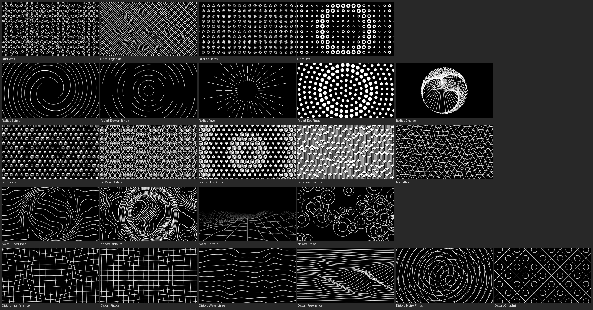

# PatternBook

**Minimal generative patterns for Resolume, animated to the beat.**

PatternBook draws calm, graphic patterns (Truchet tiles, spirals, broken
rings, string-art chords, isometric cubes, noise landscapes, flow lines, warped meshes,
resonating line fields, moiré, Chladni figures) in two colours and moves them in
time with Resolume's BPM. A **Hit**, by hand or on the beat, sends a wave out
from the centre that turns tiles, flips cubes or pushes the mesh.

PatternBook is a native FFGL source plugin for **Resolume Arena and Avenue** on
**macOS and Windows**.



- 24 patterns in five families: Grid, Radial, Isometric, Noise and Distortion
- Line width in pixels, so lines stay equally sharp at any output resolution
- Animation speed locked to Resolume's BPM, from still to one cycle per beat
- **Hit** button and automatic hits on the beat, with their own strength
- Ink and paper colours, each with alpha, so the paper can be transparent
- About 2 ms per frame in 1080p on an Intel Iris Plus for most patterns,
  up to 8–9 ms for the 3D ones (Noise Heights, Circles, Terrain; Terrain
  with the highest mountains about 11 ms)

## Download and install

1. Download the zip for your system from the
   [Releases page](https://github.com/yastefan/PatternBook-ffgl/releases).
2. Quit Resolume.
3. Copy the plugin from the zip into Resolume's **Extra Effects** folder:

   | System  | File from the zip    | Folder |
   |---------|----------------------|--------|
   | Windows | `PatternBook.dll`    | `Documents\Resolume Arena\Extra Effects` |
   | macOS   | `PatternBook.bundle` | `Documents/Resolume Arena/Extra Effects` |

   For Avenue, use `Resolume Avenue` instead of `Resolume Arena` in the path.
4. **macOS only:** macOS blocks plugins downloaded from the internet. Open
   Terminal in that folder and run:

   ```bash
   xattr -dr com.apple.quarantine PatternBook.bundle
   ```

5. Start Resolume. PatternBook appears in the **Sources** tab.

Requirements: Resolume Arena or Avenue 7 and a graphics card with OpenGL 4.1.

## Patterns

| Family | Patterns | Animation | Hit |
|---|---|---|---|
| Grid | Arcs, Diagonals, Squares, Dots | tiles make quarter turns, squares turn in a wave, dots breathe | tiles turn as the wave passes |
| Radial | Spiral, Broken Rings, Rays, Dot Rings, Chords | spiral and rings spin, rays grow and shrink, dot rings slide past each other, chord figures (cardioid, nephroid, stars) morph as their factor sways | twist, gaps open, rays and dots swell, chords jump ahead and slide back |
| Isometric | Cubes, Wire Cubes, Hatched Cubes, Noise Heights, Lattice | cubes shrink and grow in a wave, wire cubes flip inside out, columns of cubes rise and fall like terraces, lattice weaves | cubes pop, wire cubes flip, columns surge |
| Noise | Flow Lines, Contours, Terrain, Circles | streams bend around drifting eddies, contour map evolves, flight through the valleys of a wireframe landscape (Form raises the mountains), scattered rings drift and breathe | streams twist, a ridge rises, mountains jump, circles swell |
| Distortion | Interference, Ripple, Wave Lines, Resonance, Moire Rings, Chladni | mesh pushed by waves from 2–5 sources (set by Seed), ripples, fabric, a band of lines that fan out and cross where three sine generators resonate, orbiting ring centres, Chladni figures morph from mode to mode | a ring of displacement runs outwards, Resonance swells sideways from the middle, Chladni moves to the next mode |

## Parameters

### Pattern

| Parameter | What it does |
|---|---|
| **Pattern** | Which of the 24 patterns to draw, grouped by family. |
| **Seed** | Picks a different random layout (0–99). |
| **Scale** | Cells across the frame height, from 2 to 48. In Radial: Chords, the number of lines (20 to 480). |
| **Form**, **Form 2**, **Form 3** | Three pattern-specific controls; every pattern uses all three, and the display names what each does (see the table below). |
| **Line Width** | In pixels, from 0.5 to 24. |
| **Rotation** | Turns the whole pattern. In Noise: Terrain it turns the camera instead, so the flight pans and heads off in a new direction. |

#### What Form, Form 2 and Form 3 do

| Pattern | Form | Form 2 | Form 3 |
|---|---|---|---|
| Grid: Arcs | ribbon | lines | density |
| Grid: Diagonals | lines | density | direction |
| Grid: Squares | size | nested | roundness |
| Grid: Dots | dot size | wavelength | ring |
| Radial: Spiral | arms | tightness | hole |
| Radial: Broken Rings | gaps | segments | speed spread |
| Radial: Rays | inner radius | count | lengths |
| Radial: Dot Rings | dot size | density | slide |
| Radial: Chords | factor | inner radius | span |
| Iso: Cubes | scatter | contrast | size |
| Iso: Wire Cubes | inner cube | outline | size |
| Iso: Hatched Cubes | hatching | top hatching | size |
| Iso: Noise Heights | height | feature size | terraces |
| Iso: Lattice | weave | weave length | families |
| Noise: Flow Lines | turbulence | feature size | detail |
| Noise: Contours | levels | feature size | detail |
| Noise: Terrain | height | valley width | view distance |
| Noise: Circles | rings | density | size spread |
| Distort: Interference | wavelength | sources | source distance |
| Distort: Ripple | wavelength | falloff | sharpness |
| Distort: Wave Lines | frequency | cross wave | vertical change |
| Distort: Resonance | band width | crossing | left calm |
| Distort: Moire Rings | spacing | ring ratio | orbit |
| Distort: Chladni | complexity | levels | warp |

### Animation

| Parameter | What it does |
|---|---|
| **Speed** | How fast the animation runs, locked to Resolume's BPM: from stopped to one cycle per beat. The display shows the cycle length in bars. Moving it changes the pace without a jump. |
| **Amount** | How strong the animation is: how many tiles turn, how far things swing, how fast things spin or fly. 0 holds the pattern still. |
| **Motion** | **Endless** (default) keeps everything moving forward without ever swinging back: chords roll round themselves, squares keep turning, dashes run out along the rays, the lattice glides. **Sway** swings these back and forth instead (chords then morph through their factor, rays grow and shrink). All other patterns already move endlessly and ignore it. |
| **Hit** | Sends a wave out from the centre. |
| **Hit Amount** | How strong a hit is: how far its wave pushes, how high the terrain jumps, and what share of tiles and cubes it turns. 0 switches hits off. |
| **Hit Every** | Fires Hit automatically every beat up to every 8 bars. |

### Ink and Paper

Two colour pickers: **Ink** for the lines and shapes, **Paper** for the
background. Set Paper's alpha to 0 to lay the pattern over other layers.

## For developers

### Building

```bash
git clone --recursive git@github.com:yastefan/PatternBook-ffgl.git
cmake -S . -B build -DCMAKE_BUILD_TYPE=Release
cmake --build build
```

On Windows use `cmake -S . -B build -A x64` and
`cmake --build build --config Release` (Visual Studio 2022). A Debug build
defines `DEBUG`, which turns on the FFGL SDK's check that the plugin leaves the
OpenGL context in its default state.

GitHub Actions builds a universal macOS bundle and an x64 Windows DLL on every
pull request, publishes **Latest build from main** on every push to `main`,
and a versioned release for tags `v<version>` that match
`project(PatternBook VERSION …)`.

Parameter IDs follow the menu order. Once a version is released, only append
parameters, or saved Resolume compositions will mix up their values. The
Pattern menu is a table in [src/PatternBook.cpp](src/PatternBook.cpp) and is
kept grouped by family.

### Testing without Resolume (macOS)

`patternbook-harness` loads the built plugin like a host, renders offscreen on
an OpenGL 4.1 core context and writes PNG frames:

```bash
./build/patternbook-harness --plugin build/PatternBook.bundle --out renders \
    --bpm 120 --frames 240 --every 30 --set Pattern=8 --at 60 Hit=1 --at 61 Hit=0
```

`--list` prints the parameter names, `--throughput` measures frame time.

### How it works

Everything is drawn in a full-screen fragment shader
([src/Shaders.h](src/Shaders.h)), compiled once per family so each program
stays small. Each pattern computes, per pixel, how much ink covers it, from
distances to lines and shapes anti-aliased over one pixel. Warped and noise
patterns use screen-space derivatives so lines keep their width however the
field is bent. Noise: Terrain ray-marches a tileable height map that the
plugin builds once at start-up, which is far cheaper than computing noise at
every step. The landscape sinks into a valley along the flight line, and the
plugin reads the same map on the CPU to keep the camera just above the valley
floor, so it flies through the mountains rather than over them. Radial: Chords
is the one pattern drawn as geometry: each chord is a thin quad generated in
the vertex shader, because testing hundreds of long lines per pixel would be
far too slow. The clock, rate and hits run on the CPU
([src/PatternBook.cpp](src/PatternBook.cpp)).

The patterns are original implementations of well-known generative techniques
(Truchet tiles, Archimedean spirals, isometric tilings, gradient and value
noise, stream functions, interference, moiré, Chladni plate modes and
modular-multiplication chords)
and are not taken from any pattern collection.

## License

PatternBook is free software under the [GNU General Public License v3.0 or
later](LICENSE). The FFGL SDK is © Resolume and contributors under its own
license, included with each release.
